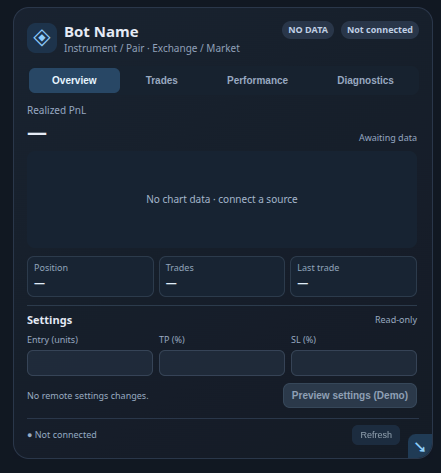
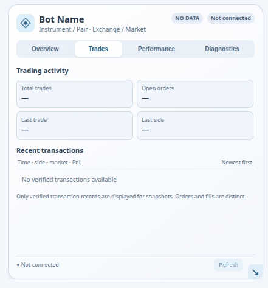
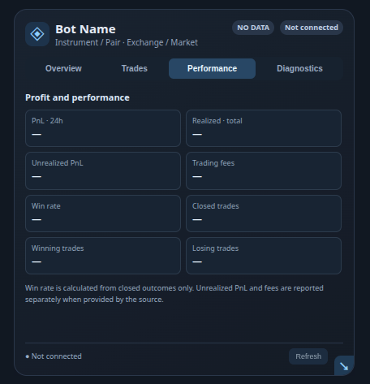
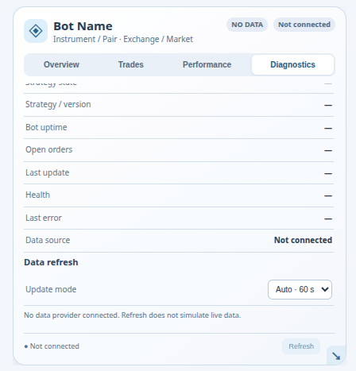
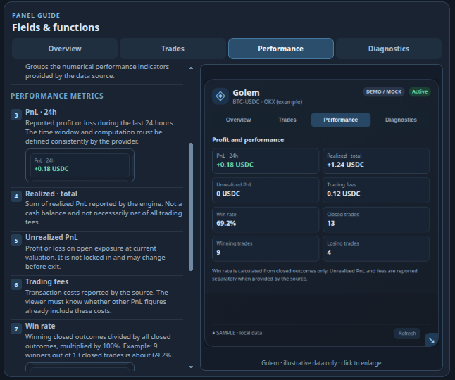
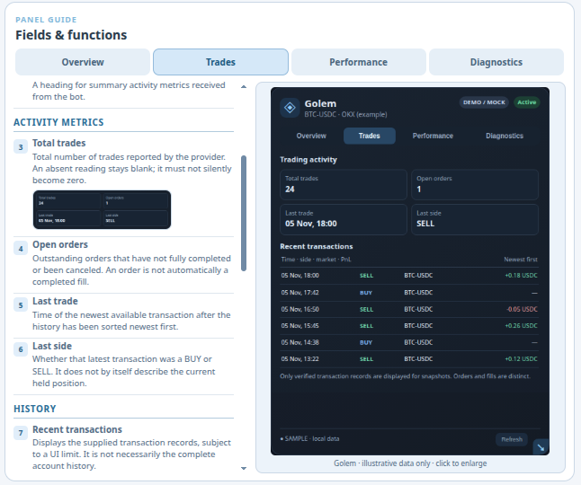

# KVM BotPanel

**A responsive, reusable bot-monitoring interface — a KingVMai portfolio case study.**

**Project status:** Owner-accepted local UI prototype. The approved interface and documentation scope was completed on 10 November 2026. Updated theme and recovery checks passed on 11 November 2026. **Not deployed and not connected to a trading engine.**

**Description:** Universal, responsive interface for bot monitoring and control, designed for use on the MEXPTH website.

This is a **public, documentation-only portfolio repository**. The implementation, private development history, credentials, operational data and canonical QuestMap are intentionally withheld.

## The problem and solution

When multiple bots use different interfaces, monitoring information becomes harder to compare. KVM BotPanel establishes a consistent, reusable interface layout. Visual behavior can be designed, inspected and tested separately from trading engines and account connections.

## Demonstrated capabilities

- A reusable framework-independent Web Component with four views: **Overview, Trades, Performance and Diagnostics**.
- Adjustable width, synchronized slider and resize handle, layout and density controls, plus a 100% reset.
- A four-tab illustrated **Panel Guide**, with independent scrolling and enlarged image previews.
- Responsive desktop/mobile layout and **System, Day and Night** appearance modes. System follows operating-system theme changes.
- A deliberately **empty reference instance**. Guide examples are illustrative, not live bot positions or trading results.

## Verified results

**100% of the owner-approved local UI and documentation scope was completed.** This is a scoped milestone, **not** a claim that integration or production deployment is finished.

- **27/27 automated tests passed.**
- Browser layout tests passed at **1366, 1188, 1000, 970, 850 and 480 px**.
- Automatic system-theme and manual theme controls passed at **1366, 1000 and 480 px**.
- An isolated clean-copy recovery test passed, including all four guide tabs and active image resources.

See [Architecture](docs/ARCHITECTURE.md) and [Validation and limitations](docs/VALIDATION.md).

## My role and AI-assisted execution

**My contribution:** I defined the concept, requirements, interface priorities and scope; evaluated iterations; reviewed diagnostic and test results; requested corrections; and accepted the completed local UI.

**AI's contribution:** AI-assisted tooling performed software implementation, code changes, test automation, documentation and Git operations under my direction. I do **not** claim to have independently programmed the application. The case study demonstrates requirements definition, product ownership, iterative QA, troubleshooting and AI task orchestration.

## Screenshots

Six screenshots from the local project are presented in dark/light pairs. These copies preserve the captured image pixels and exclude original PNG metadata. They illustrate the interface; they do not demonstrate connected bot operation.

| Dark theme | Light theme |
| --- | --- |
|  |  |
|  |  |
|  |  |

No demonstration videos are included.

## Scope and limits

KVM BotPanel is a verified **local UI reference**, not a public SaaS application or operational trading service. No trading account, exchange API, live or demo engine, user authentication or real financial results are connected to this reference page. **MEXPTH is the intended future host**, not an existing deployment.

The private source code is not published or licensed through this showcase. The full working project remains in a separate private repository.

**KingVMai · Project portfolio · November 2026**
